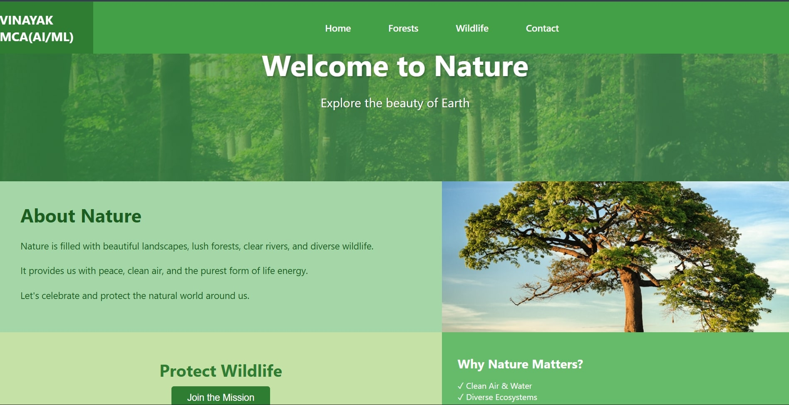

<div align="center">

# Nature Theme Grid Layout — Responsive Webpage
### Fluid CSS Grid Architecture, Multi-Breakpoint Ergonomics & Modern UI Design

[](https://vinayaknaturethemegridlayout.netlify.app/)
[](https://developer.mozilla.org/en-US/docs/Web/CSS/CSS_grid_layout)
[](https://developer.mozilla.org/en-US/docs/Web/HTML)
[](https://developer.mozilla.org/en-US/docs/Learn/CSS/CSS_layout/Responsive_Design)
[](LICENSE)

<p align="center">
  <b>A responsive nature-themed webpage built using HTML5 semantic elements and CSS Grid multi-track containers.</b><br>
  Demonstrating advanced grid template areas, fractional track distribution, fluid typography, and seamless device adaptation.
</p>

<p align="center">
  <a href="https://vinayaknaturethemegridlayout.netlify.app/" target="_blank">
    
  </a>
  <br><br>
  <b>🚀 Live Interactive Website:</b> <a href="https://vinayaknaturethemegridlayout.netlify.app/">https://vinayaknaturethemegridlayout.netlify.app/</a>
</p>

---

</div>

## Executive Summary

Modern web design requires layout architectures that dynamically adapt to heterogeneous viewports without brittle float hacks or excessive CSS framework overhead.

The **Nature Theme Grid Layout Project** demonstrates the power and precision of pure **CSS Grid**. Inspired by organic landscapes (forests, alpine summits, and rivers), the application organizes visual and textual hierarchies into mathematically balanced grid regions. Using CSS `grid-template-areas`, `minmax()`, and media query breakpoints, the layout morphs seamlessly from multi-track desktop dashboards down to single-column mobile reading streams.

---

## 🎥 Interactive Video Walkthrough & UI Showcase

<div align="center">

<video src="https://github.com/vsbeginner/grid-layout-assignment/raw/main/Nature%20Grid%20Layout%20Demo.mp4" controls="controls" width="100%"></video>

<sub><b>Interactive Walkthrough:</b> Responsive CSS Grid layout adapting fluidly across desktop, tablet, and mobile breakpoints.</sub>

<br><br>

<br>
<sub><b>Visual Layout:</b> Multi-column CSS Grid architecture with nature-themed aesthetic.</sub>

</div>

---

## Architectural Taxonomy & Grid Wireframe

The viewport is divided into named semantic grid zones that reflow dynamically based on screen width:

```
┌────────────────────────────────────────────────────────────────────────────────────────┐
│                              DESKTOP CSS GRID ARCHITECTURE                             │
├────────────────────────────────────────────────────────────────────────────────────────┤
│                                  [ HERO & NAV HEADER ]                                 │
├───────────────────────────────┬───────────────────────────────┬────────────────────────┤
│       [ CONTENT ZONE A ]      │       [ BANNER SHOWCASE ]     │   [ HIGHLIGHT DECK ]   │
│     (Forests & Ecosystems)    │     (High-Resolution Media)   │     (Quick Facts)      │
├───────────────────────────────┴───────────────────────────────┴────────────────────────┤
│                                   [ IMAGE GALLERY ]                                    │
│                 (Four-Column Responsive Fractional Tracks: 1fr 1fr 1fr 1fr)            │
├────────────────────────────────────────────────────────────────────────────────────────┤
│                                     [ FOOTER ]                                         │
└────────────────────────────────────────────────────────────────────────────────────────┘
```

---

## Core Technical Features

| Feature Module | Technical Implementation | Design Impact |
|:---|:---|:---|
| **Explicit Grid Areas** | Built with `grid-template-areas` and fractional unit sizing (`fr`). | Eliminates float positioning and clears; guarantees pixel-level alignment. |
| **Adaptive Breakpoints** | CSS3 `@media` rules restructuring desktop matrices into mobile stacks ($\le 768\text{px}$). | Zero horizontal overflow on mobile viewports. |
| **Micro-Interactions** | CSS transitions on link states, image hover zoom, and call-to-action buttons. | Delivers tactile feedback without JavaScript animation libraries. |
| **Semantic Structure** | Encapsulated in `<header>`, `<nav>`, `<main>`, `<article>`, `<section>`, and `<footer>`. | Maximizes accessibility (a11y) and SEO parsing. |

---

## Technical Specifications & Stack

- **Markup Architecture**: HTML5 Semantic Elements
- **Layout Engine**: CSS3 Grid Specification (`grid-template-columns`, `grid-template-rows`, `grid-area`)
- **Fluid Mechanics**: CSS Flexbox for micro-alignments + Media Queries
- **Deployment Platform**: Netlify Continuous Delivery

---

## Quickstart & Local Reproduction

```bash
# Clone the repository
git clone https://github.com/vsbeginner/grid-layout-assignment.git
cd grid-layout-assignment

# Option 1: Open directly in your default browser
start index.html

# Option 2: Serve locally
python -m http.server 3000
```

---

## Candidate Profile & Institutional Details

- **Candidate Name**: Vinayak Sharma
- **Enrollment / Roll No**: 2501940012
- **GitHub Profile**: [@vsbeginner](https://github.com/vsbeginner)
- **LinkedIn Profile**: [Vinayak Sharma](https://www.linkedin.com/in/vinayak-sharma-24a8aa384/)
- **Email Contact**: vsbeginner14@gmail.com
- **Degree Program**: Master of Computer Applications (MCA)
- **Institution**: Department of Computer Science & Engineering, K.R. Mangalam University

---

<div align="center">
  <sub>Developed for academic excellence and technical portfolio showcase. Licensed under the <a href="LICENSE">MIT License</a>.</sub>
</div>
